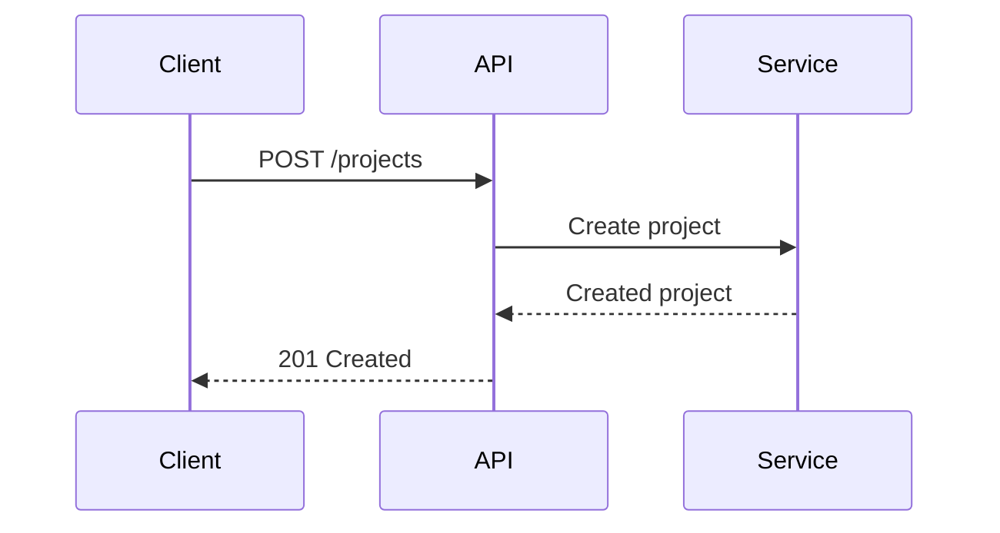

# From source code to API documentation

SpecKub helps your coding agent turn existing HTTP APIs into detailed, Git-versioned Markdown specifications. Use the CLI to install the workflow, check documents, and export a reader. Use your agent to understand the implementation and write the documentation.

The workflow is **scan → relations → create → read**, with optional **validate**, **clarify**, and **template** skills. Your API can use any language or framework; the agent follows your source code and reports routes it cannot resolve.

## What you need

- **Node.js 22+** to run the CLI. Your API does not need to use Node.js.
- A supported coding agent with access to your project: Codex, Claude, or Cursor.
- An API repository you can inspect and a normal Git review workflow.

Discovery uses your coding agent's capabilities and account. SpecKub does not provide a hosted AI service or guarantee complete coverage of dynamic routing. You review the inventory and documentation before committing them.

## Quickstart

Here is a walkthrough for an existing service. Run terminal commands from the API project's root, not from the SpecKub source repository.

### 1. Install and initialize

**Terminal · install once, initialize each project**

We recommend a global installation. SpecKub is a documentation CLI; your API does not need to depend on it or have an npm manifest.

```sh
npm install --global @speckub/cli
speckub init --agent codex
```

Install once on your machine, then run `speckub init` from each API project's root. For Claude, Cursor, or every integration, replace `codex` with `claude`, `cursor`, or `all`. Initialization creates skills, an editable template and example in `.speckub/`, and a default `docs/api/` directory. Existing files, including project instructions and custom templates, are preserved.

### Optional: pin the CLI to a project

If your team wants a project-managed CLI version, use a development dependency instead. These commands are an alternative to the recommended global installation.

**npm**

```sh
npm install --save-dev @speckub/cli
npx speckub init --agent codex
```

**Yarn**

```sh
yarn add --dev @speckub/cli
yarn speckub init --agent codex
```

For a local installation, use `npx speckub` or `yarn speckub` wherever the rest of this guide uses `speckub`.

### 2. Discover and document in agent chat

Open a **new agent session** in the initialized project so it discovers the installed skills. For Codex, send these separately, reviewing the output between steps:

```text
$speckub-scan Find the HTTP endpoints in this project. Report uncertain routes separately.
```

```text
$speckub-relations Map confirmed APIs to their callers and downstream services.
```

```text
$speckub-create Document the confirmed endpoints with request and response JSON, errors, and sequence diagrams.
```

For Claude or Cursor, use `/speckub.scan`, `/speckub.relations`, and `/speckub.create`. These are **agent-chat instructions**, not shell commands. Codex skill names use hyphens: `$speckub-scan`, not `/speckub.scan`.

### 3. Read the result

**Terminal**

```sh
speckub list
speckub ui --serve
```

Open the printed local URL. You can search endpoints, filter methods, switch between List and Tree, and read the contracts and diagrams. Review the generated Markdown and Git diff before committing. Rerun `ui` whenever specs change.

## Scan

The scan skill inspects routing, handlers, middleware, route prefixes, and deployment configuration. It writes an inventory to `.speckub/scan.md`, with source evidence and unresolved coverage gaps. This step prepares the list of APIs; it does not create endpoint specifications.

To narrow the work, include a service directory, route prefix, specific file, or natural-language scope:

```text
$speckub-scan Scan only services/payments/. Include mounted route prefixes and report unresolved dynamic routes.
```

The terminal command `speckub scan` prepares skills and prints a handoff prompt. It does not run an AI scan by itself. Paste the handoff into your coding agent.

## Relations

Before writing individual specs, map the confirmed APIs to callers, internal services, storage, and external dependencies. The agent records the result in `.speckub/relations.md`.

```text
$speckub-relations Focus on the payments APIs. Trace service calls and identify evidence for each relationship.
```

Treat unknown relationships as unknown. A matching name or a guessed route is insufficient evidence. Review the mapping before generating diagrams and endpoint documents.

## Create

Create produces a Markdown file for each confirmed endpoint, normally under `docs/api/`. Existing IDs and document locations are preserved when updating specs. A useful document covers:

- Purpose, consumers, method, full route, authentication, and authorization.
- Parameters, headers, JSON request examples, response shapes, and defaults when established by source.
- Status codes, error cases, business rules, side effects, and operational limits.
- Callers, downstream services, source references, and a Mermaid request-flow diagram.
- Evidence, verification status, and unresolved questions.

```text
$speckub-create Create specs for the confirmed payments APIs. Use our template, include success and error JSON, and mark unknown behavior explicitly.
```

Do not invent JSON bodies for endpoints that have none. Describe path/query/header inputs instead. Review source-backed examples and diagrams as carefully as code.

## Custom templates

Your editable template is `.speckub/templates/api.md`. The illustrative example is `.speckub/examples/api.md`. Change the headings, section order, tables, language, terminology, and examples to fit your team. The agent replaces placeholders with evidence; placeholders are authoring aids, not executable template syntax.

Use the template skill to design or refine the format:

```text
$speckub-template Design a template for our internal APIs. Include request JSON, errors, authorization, dependencies, and a Mermaid sequence diagram.
```

Create then uses that template. A custom Markdown body does not require a custom renderer. Keep the metadata fields below so discovery and the reader can identify each endpoint.

### Metadata example

This is an illustrative endpoint. Use actual route details and real repository-relative source paths in your own files.

```yaml
---
speckub: true
specVersion: 1
id: users.read
kind: http
method: GET
path: /users/{id}
summary: Read a user
source:
  - api/users.ts
---
```

`id` is a stable identifier; preserve it across route renames. Use distinct IDs across services. `speckub: false` opts templates or examples out of discovery. Ordinary Markdown is ignored. Older HTTP specs with `specVersion` and `kind: http` remain discoverable without the marker.

### JSON and diagrams

Use fenced code blocks for request/response examples. Include realistic sample values and clearly indicate required or optional fields. Keep secret values out of examples.

````markdown
## Request example

```json
{
  "name": "Example project",
  "visibility": "private"
}
```

## Request flow


````

Sequence diagrams should follow the actual implementation. The reader supports Mermaid Tiny; unsupported diagram types retain their source. Raw HTML and remote images are disabled.

## Validate and clarify

Copy a real endpoint ID from `list` and check it:

```sh
speckub validate --id users.read --json
```

The CLI checks document structure and cited source references. **Semantic validation remains `skipped`**: a successful structural check does not prove that the application implements the documented behavior. Run the project's own tests as well.

For an optional AI source review:

```text
$speckub-validate Review users.read against its source. Separate verified facts from unresolved behavior.
```

When you spot a wrong detail, clarify it with evidence:

```text
$speckub-clarify Review users.read: this route requires an authenticated user. Check the middleware, then correct the spec and request flow.
```

Review the changes, preserve the existing ID, and regenerate the reader. The AI review is a supplement to tests and human review.

## Read and share

The CLI reader discovers eligible Markdown throughout the selected project root, including specs stored alongside services. Dependencies, generated output, `.speckub`, and agent configuration directories are excluded. Use `--docs-dir` only when you want to restrict discovery.

```sh
speckub ui --serve
```

The reader defaults to **List**. Choose **Tree** and set **Max tree layers** from 1–12 to group deep API paths. Endpoints below the cap remain listed. Your view preference is saved in the browser when storage is available.

### Public GitHub repositories

[Open the public repository explorer](/explorer.html), paste `owner/repository` or a GitHub URL, then choose a branch. It reads existing SpecKub documents; it does not run discovery skills or generate docs.

Try [the CRUD playground on its feature branch](/explorer.html?repo=ipondnakab%2Fspeckub&branch=feat%2Fcrud-deep-path-playground&endpoint=projects.list) to open `projects.list` and explore nested API routes.

Search, filter available methods, and use **Copy link** to share an endpoint. Shared links follow the selected branch when reopened; source links point to the exact loaded commit. The explorer reads Markdown across the branch, so custom document locations work.

GitHub's anonymous API quota and file/download limits apply. Cached snapshots may be shown with their timestamp during temporary failures. Caching reduces repeated requests but does not remove the quota. A first uncached visit may need to wait for GitHub's reset time.

### Private repositories

Use the local CLI reader for private code:

```sh
speckub ui --out .speckub/site --serve
```

The export includes its scripts, styles, diagrams, and spec content for offline use. Preview binds to `127.0.0.1`. Without `--serve`, open the generated `index.html` or host the complete output directory.

The export has **no built-in authentication**. A private GitHub repository does not protect a separately hosted export. Use your own access-controlled host for internal sharing. Source files and environment files are not copied; spec text and source-reference paths are included. Regenerate the export after edits.

## CLI reference

Run these in the project root with the recommended global installation: `speckub COMMAND`. If you chose a project-local dependency, use `npx speckub COMMAND` or `yarn speckub COMMAND` instead.

| Command              | Purpose                                                                                         |
| -------------------- | ----------------------------------------------------------------------------------------------- |
| `init --agent codex` | Install project instructions, skills, and templates. Also accepts `claude`, `cursor`, or `all`. |
| `scan`               | Prepare skills and print an AI handoff prompt.                                                  |
| `list`               | List discovered endpoint IDs, methods, paths, and document locations.                           |
| `inspect ID`         | Inspect an existing endpoint specification.                                                     |
| `validate --id ID`   | Check document structure and source references.                                                 |
| `ui`                 | Export a static spec reader. Add `--serve` for local preview.                                   |
| `--help`             | Show the CLI's command syntax.                                                                  |

Use `--root DIR` to choose a project, `--docs-dir DIR` to narrow document discovery, and `--json` for supported machine-readable output. Reader options include `--out DIR`, `--serve`, and `--port NUMBER`. Output must be a dedicated directory inside the selected project; nonempty directories are protected unless they are recognized reader exports.

### Nested API project

From the parent repository:

```sh
speckub init --root portfolio-api --agent all
speckub list --root portfolio-api
speckub ui --root portfolio-api --serve
```

Open the agent in the selected API project. Keep source references relative to that root. If existing project instructions were preserved during initialization, review them and add the relevant workflow guidance without overwriting your team's rules.

## Troubleshooting

### The skill is not available

Confirm initialization ran in the root your agent has open. Start a new agent session after installing skills. In Codex, use `$speckub-scan`; in Claude/Cursor, use `/speckub.scan`. As a fallback, ask the agent to read `.agents/skills/speckub-scan/SKILL.md` and follow it. Do not paste an agent skill name into a terminal.

### List is empty or endpoint not found

Initialization creates the authoring setup, not endpoint specs. Run scan, relations, and create with your agent. Check that your documents have eligible frontmatter, unique IDs, and the intended `--root`. `users.read` in this guide is only an example ID.

### The package or command is not found

Install `@speckub/cli`, not only `@speckub/schema`. After a global installation, confirm `speckub --help` works and that your package manager's global executable directory is on your shell PATH. For local installs use `npx speckub` or `yarn speckub`. A just-published package may still be processing.

### My reader still looks old

Run `npm install --global @speckub/cli@latest` to upgrade the global CLI, then rerun `speckub ui` to replace generated assets. An existing export does not update itself. Hard-refresh the browser if it still has cached assets.

### Can I use this with any language?

The AI workflow is framework-independent and inspects source, rather than relying on a fixed list of parsers. Coverage depends on the agent and repository. Dynamic routes, generated registration, missing services, and unsupported non-HTTP protocols should be reported as gaps, not silently guessed.

### Which package do I need?

Most users need **`@speckub/cli`**. **`@speckub/schema`** provides schema and Markdown-frontmatter parsing for integrations; **`@speckub/core`** provides discovery and source-reference checks. Schema and core are libraries, not shell commands.

## Keep docs close to code

Commit the Markdown with your implementation changes, preserve stable IDs, and review contracts and diagrams in the same pull request. Update existing specs when behavior changes. Re-run the project's tests and regenerate the reader.

[Start with the CLI source and README](https://github.com/ipondnakab/speckub/tree/main/packages/cli) · [Report an issue](https://github.com/ipondnakab/speckub/issues) · [Open the explorer](/explorer.html)
